 

  

&nbsp;

---

## `$ whoami`

Hi! I'm **Shruti Pawar**, a third-year Computer Engineering student at **Usha Mittal Institute of Technology, SNDT Women's University, Mumbai**.

- 💻 Interested in backend development, web applications, and software engineering.
- ☕ I enjoy building practical projects and understanding how systems work behind the scenes.
- 🧩 Exploring APIs, databases, application architecture, and AI-powered applications.
- 🌱 Currently strengthening my Java, Spring Boot, React, and system design skills.
- 🎀 Vice Chairperson of the **SNDT ACM-W Student Chapter (2026–27)**.

> `build()` → `learn()` → `improve()` → `repeat()`

---

## `$ tech-stack`

**Languages**

  

**Frontend**

  

**Backend & Databases**

  

**Developer Tools**

---

## `$ ls ./projects`

<table>
<tr>
<td width="50%" valign="top">

### 🔔 Notiflow

A notification-focused application with a Spring Boot backend.

`Java` `Spring Boot`

[View Repository ↗](https://github.com/shrutip04/notiflow)

</td>
<td width="50%" valign="top">

### 🔗 LinkVault

A web application for organizing and managing useful links.

`Web Development`

[View Repository ↗](https://github.com/shrutip04/LinkVault)

</td>
</tr>
<tr>
<td width="50%" valign="top">

### 🛡️ Password Security Analyzer

A project focused on password strength and security feedback.

`Web Development` `Security`

[View Repository ↗](https://github.com/shrutip04/password-security-analyzer)

</td>
<td width="50%" valign="top">

### 📚 ResearchSphere

A research-paper discovery platform built around database design and paper exploration.

`React` `Node.js` `Express` `PostgreSQL`

[View Repository ↗](https://github.com/shrutip04/research-paper-repository)

</td>
</tr>
</table>

---

## `$ experience --list`

**Full-stack Intern — Finabits Software Solutions**

- Working with Spring Boot backend development and React frontend development.

**Frontend Developer Intern — ANMA KIDS**

- Built the organization's website using Framer.

---

## `$ community --leadership`

**Vice Chairperson — SNDT ACM-W Student Chapter (2026–27)**

- Supporting chapter activities, student engagement, and technical initiatives.

**Creative Head — SNDT ACM-W Student Chapter (2025–26)**

- Contributed to event creatives, social media content, and chapter communications.

---

## `$ open-source`

- 🌐 Contributor at **GirlScript Summer of Code 2026**.
- 🤝 Exploring collaborative development and open-source contribution workflows.
- 🌱 Continuously learning through projects, experimentation, and collaboration.

---

## `$ github-analytics`

---

## `$ contributions`

<picture>
  <source media="(prefers-color-scheme: dark)" srcset="https://raw.githubusercontent.com/shrutip04/shrutip04/output/github-contribution-grid-snake-dark.svg">
  <source media="(prefers-color-scheme: light)" srcset="https://raw.githubusercontent.com/shrutip04/shrutip04/output/github-contribution-grid-snake.svg">
  
</picture>

---

## `$ connect`

&nbsp;

&nbsp;

&nbsp;

  

<code>thanks for stopping by &lt;3</code>

 

